<div align="center">


# AIEvoPet

[English](./README.md) · **简体中文**

> 一只活在你屏幕角落的 AI 桌宠，<br/>
> 记得你是谁，陪你一起长大。

[](./LICENSE)
[](./art/LICENSE)
[](https://tauri.app)
[](https://react.dev)
[](#-本地-ai-配置)
[](./CONTRIBUTING.md)
[](https://github.com/aievopet/aievopet)

<br/>

<a href="src/assets/pet/generated/prompt-1-v1.png">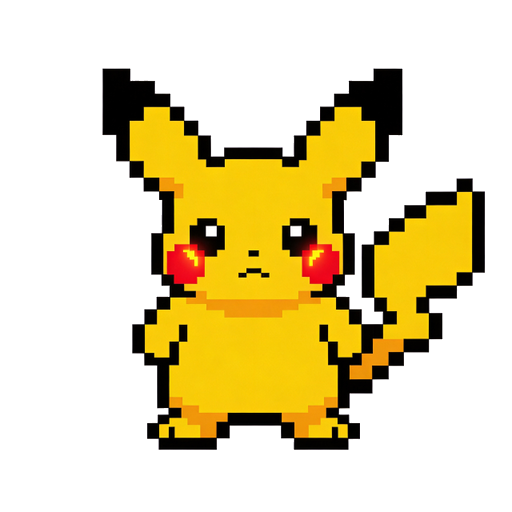</a>
<a href="src/assets/pet/generated/prompt-2-v1.png">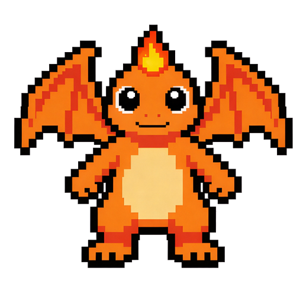</a>
<a href="src/assets/pet/generated/prompt-3-v1.png">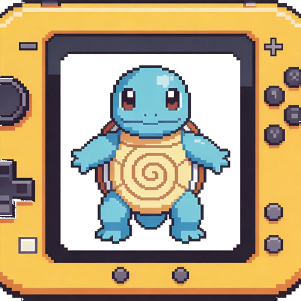</a>
<a href="src/assets/pet/generated/prompt-7-v1.png">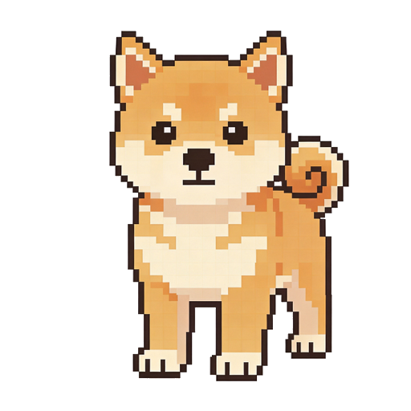</a>
<a href="src/assets/pet/generated/prompt-9-v1.png">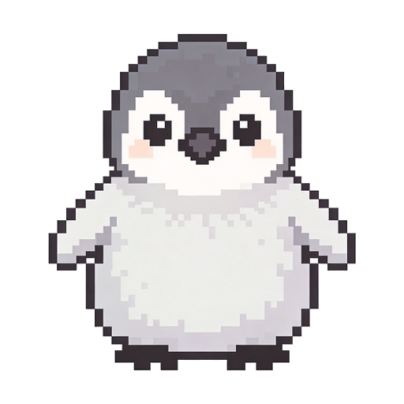</a>
<a href="src/assets/pet/generated/prompt-11-v1.png">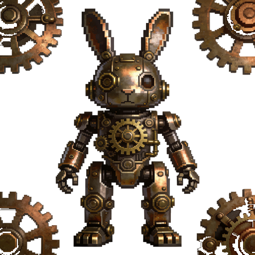</a>
<a href="src/assets/pet/generated/prompt-12-v1.png">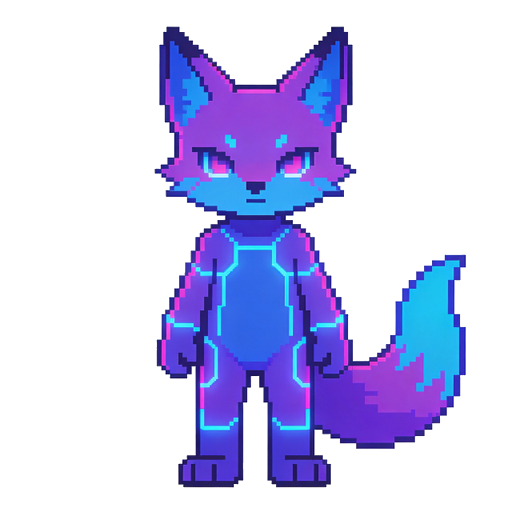</a>
<a href="src/assets/pet/generated/prompt-39-v1.png">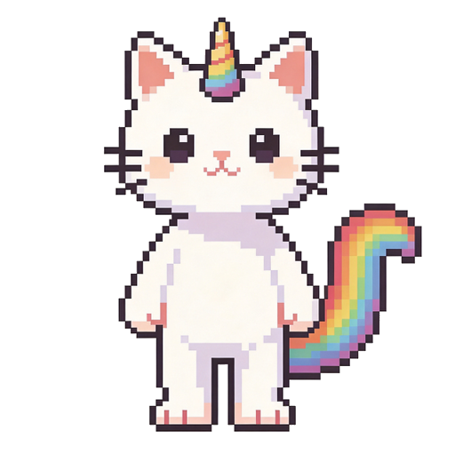</a>

<sub>63 种宠物中的 8 只 —— 全部一张张提示词出来的像素美术。</sub>

<br/>

[**⭐ 给个 Star**](https://github.com/aievopet/aievopet) · [**🐛 报 Bug**](https://github.com/aievopet/aievopet/issues/new/choose) · [**💡 提需求**](https://github.com/aievopet/aievopet/issues/new/choose) · [**🤝 提 PR**](./CONTRIBUTING.md)

</div>

---

## 这是什么？

AIEvoPet 是一个 **本地优先、开源** 的 AI 桌宠。

它不是托盘里的另一个聊天框。它是一只真的小生物：在你屏幕上走动，记得你们昨天聊过什么，凌晨两点会犯困，从蛋里孵化出来，会挑你给它买的衣服，还会在你 `cargo build` 终于过的那一刻跳到你正在看的屏幕上提醒你——这一切都 **100% 跑在你自己的电脑上**，不上云，不打点。

你可以把它想成 *电子宠物 × QQ 宠物 × Cursor 助理*，用 2026 年的 Tauri + Rust + 本地大模型重写了一遍。

---

## 为什么你会喜欢它

| | |
|---|---|
| **本地优先的 AI** | 默认连本地 Ollama（`qwen3:4b-instruct`）。宠物的记忆、对话、意图识别永远不出你的电脑。 |
| **真的是宠物，不是面板** | 会走、会睡、会饿、会从蛋里孵出来，有亲密度系统，能打零工，能换装，反应的是 **你**，不是一个"发送"按钮。 |
| **跟你的工作一起成长** | **Cursor** / **Claude Code** / 任意 shell 命令的开箱即用适配器 —— 测试通过或构建失败的瞬间宠物就有反应，强提醒模式下还会瞬移到你正在用的那块屏幕。详见 [`adapters/`](./adapters/README.md)。 |
| **隐私即设计** | 零遥测、零分析、零外网请求。空闲时间通过本地 OS 计数器读取。所有数据都在 `~/Library/Application Support/AIEvoPet/`。 |
| **像素美术，从头到尾** | 63 种宠物 + 95+ 件穿搭，全部一张张提示词出来再 commit 进仓库。美术 CC BY 4.0 协议，随便 fork、随便 remix。 |
| **小体积、真桌面 App** | Tauri 2 + Rust 内核。macOS 安装包 ~10MB，空闲时 <50MB 内存。全平台支持（macOS Intel/ARM、Windows、Linux）。 |

---

## 盒子里有什么

<table>
<tr>
<td width="33%" valign="top">

### 一只真宠物
- 从蛋里孵化（选品种 + 取名）
- 在屏幕上自由走动
- 鼠标悬停可聊天，拖拽可移动
- 你睡它睡，会饿会无聊
- 亲密度提升解锁新行为

</td>
<td width="33%" valign="top">

### 一个小 Agent
- 本地大模型对话（Ollama）
- 记得你的偏好、名字、做了什么
- 每天自动从聊天 + 活动卷出日记
- 提醒系统（"晚 9 点提醒我喝水"）
- 语音指令如"*换成强提醒*"会真的切换底层标志

</td>
<td width="33%" valign="top">

### 一款养成游戏
- 金币系统（爪币）
- 盲盒衣柜（大模型按心情随机挑）
- 兼职打工系统（宠物会真的去上班位）
- 零食与家具货架
- 成就 + 关系阶段

</td>
</tr>
<tr>
<td width="33%" valign="top">

### 一个编程伙伴
- Cursor 和 Claude Code 的开箱 [适配器](./adapters/README.md)（hooks，无 SDK）
- `aievopet-watch` 包裹任意 shell 命令（`npm test` / `cargo build` / agent CLI 全适用）
- **强提醒模式**：任务完成时瞬移到你的活动屏 + 静音系统通知
- HTTP 桥 `127.0.0.1:44557/coding-event` 兜底其他场景

</td>
<td width="33%" valign="top">

### 一本日记
- 每天一份只追加的 `diary.json`
- 自动卷活跃分钟、对话、兼职
- 可选导入 Git 活动
- 面板内日历视图
- 一切都在本地

</td>
<td width="33%" valign="top">

### 一套创作工具
- 63 种现成宠物（[图册](#看看你未来的伙伴)）
- 95+ 件穿搭 + 摆位编辑器
- 贴纸（招呼 / 提醒 / 庆祝）
- 把新 PNG 丢进 `src/assets/wardrobe/<category>/`，自动热加载

</td>
</tr>
</table>

---

## 看看你未来的伙伴

63 种宠物里挑了几张：

<table>
<tr>
<td align="center" width="12.5%"><br/><sub>电系黄鼠狼</sub></td>
<td align="center" width="12.5%"><br/><sub>火系小龙</sub></td>
<td align="center" width="12.5%"><br/><sub>水系小龟</sub></td>
<td align="center" width="12.5%"><br/><sub>偶像系小猫</sub></td>
<td align="center" width="12.5%"><br/><sub>小企鹅</sub></td>
<td align="center" width="12.5%"><br/><sub>机械兔子</sub></td>
<td align="center" width="12.5%"><br/><sub>赛博狐狸</sub></td>
<td align="center" width="12.5%">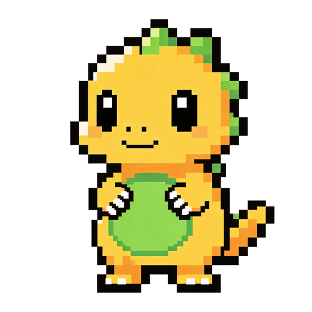<br/><sub>像素小恐龙</sub></td>
</tr>
<tr>
<td align="center">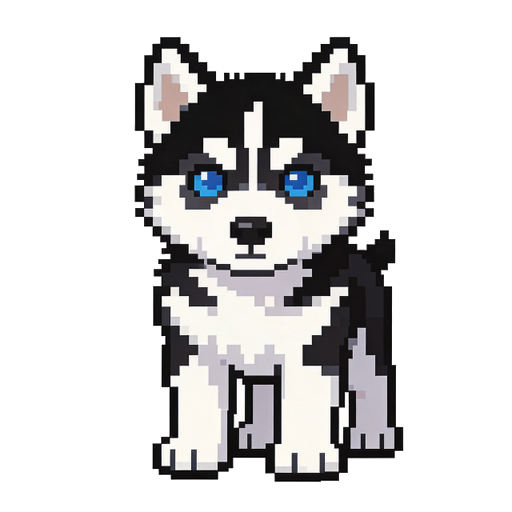<br/><sub>哈士奇幼犬</sub></td>
<td align="center"><br/><sub>独角猫</sub></td>
<td align="center">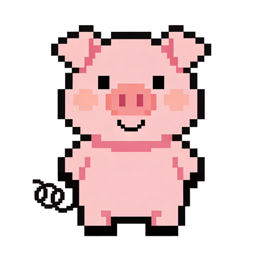<br/><sub>粉色小猪</sub></td>
<td align="center">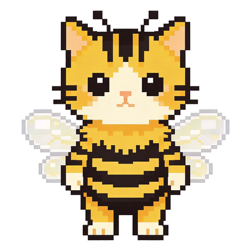<br/><sub>蜜蜂猫</sub></td>
<td align="center">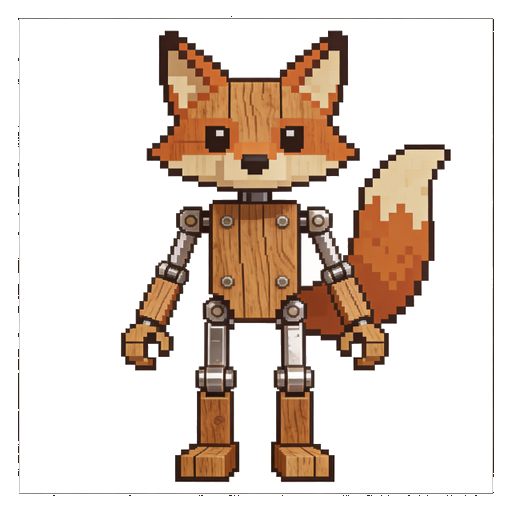<br/><sub>提线木偶狐</sub></td>
<td align="center"><br/><sub>云朵史莱姆</sub></td>
<td align="center">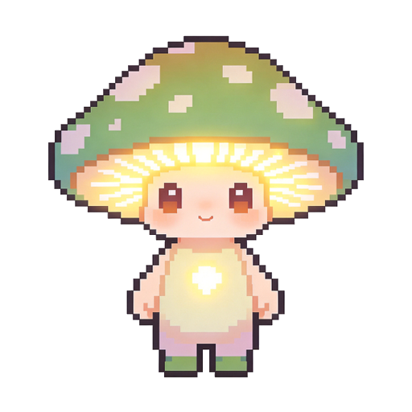<br/><sub>蘑菇小精灵</sub></td>
<td align="center"><br/><sub>柴犬幼犬</sub></td>
</tr>
</table>

> 想要的品种暂时没有？[开个 issue 加 `species-request` 标签](https://github.com/aievopet/aievopet/issues/new/choose) 描述你想要什么 —— 也可以直接画好一张 32×32 PNG 提交，我们帮你接进去。

---

## Demo

> **这一段我们正在征集帮助。** 录正式 demo GIF 之前，先看看现在能跑哪些功能 —— 录一段短 loop 然后 PR 进来非常欢迎。

<details>
<summary><b>点开看完整功能演示</b></summary>

1. **第一次启动** → 给宠物起名 → 选品种 → 选模型端点 → 孵化。
2. **闲置时** → 宠物在屏幕边缘行走，你空闲它就睡，头顶冒小图标（`Zzz` / `饿` / `打工 12'` / `$?`）。
3. **聊天** → 点一下就开聊：它会记住你的偏好、名字、目标。
4. **提醒** → "*晚 9 点提醒我拉伸*" → 它真的会。
5. **编程事件** → `curl 127.0.0.1:44557/coding-event -d '{"kind":"task-done"...}'` → 如果开了 **强提醒**，宠物会瞬移到你正在看的那块屏幕 + 弹系统通知。
6. **商店** → 跟它说"想要个新衣服"，大模型会按宠物当前心情和你的爪币余额随机抽一件。
7. **日记** → 日历视图：每天的对话、兼职、活跃分钟、可选的 Git 活动。

</details>

---

## 快速上手

```bash
# 1. 克隆
git clone https://github.com/aievopet/aievopet.git
cd aievopet

# 2. 安装
npm install

# 3. 跑桌面应用（Tauri 壳 + Vite renderer）
npm run tauri:dev
```

**前置依赖**

- Node.js 20+ 和 npm 10+
- Rust 工具链（`cargo`、`rustc`），通过 [rustup](https://rustup.rs/) 安装
- 平台扩展：
  - **macOS**：Xcode Command Line Tools
  - **Linux**：`libwebkit2gtk-4.1-dev libappindicator3-dev librsvg2-dev patchelf libgtk-3-dev libsoup-3.0-dev libjavascriptcoregtk-4.1-dev`
  - **Windows**：WebView2 Runtime（Win10+ 自带）

**自检命令**

```bash
npm run typecheck   # TypeScript
npm run test        # 单元测试
npm run build       # renderer 打包
npm run test:e2e    # 窗口级流程（Playwright）
```

---

## 本地 AI 配置

宠物默认连 [Ollama](https://ollama.ai)。默认配置：

| | |
|---|---|
| Provider | `ollama` |
| Endpoint | `http://127.0.0.1:11434` |
| Model | `qwen3:4b-instruct` |

```bash
ollama pull qwen3:4b-instruct
ollama serve
```

然后启动 AIEvoPet —— 它会自动检测在跑的模型。

> 没装 Ollama 也没关系，AIEvoPet 会回退到脚本式对话，至少 onboarding 还能走完。你也可以在面板里改成任何兼容 OpenAI 的端点。

---

## 技术栈

```
┌─────────────────────────────────────────────────────────┐
│  React 19 + TypeScript 5 + Vite 7   ← renderer (UI)     │
│  Pixi.js 8                          ← 像素画布          │
│  Tauri 2（Rust 2021）               ← 桌面壳            │
│  Ollama / OpenAI 兼容               ← 本地大模型        │
│  user-idle (Rust)                   ← 空闲计数          │
│  Vitest + Playwright + Selenium     ← 测试              │
└─────────────────────────────────────────────────────────┘
```

架构和协议细节都直接写在源码注释里：

- coding-event 桥 schema —— `scripts/emit-coding-event.mjs`
- 宠物存档格式 —— `src/types/pet.ts`
- 衣柜 / 摆位模型 —— `src/types/wardrobe.ts`
- Tauri 命令 —— `src-tauri/src/lib.rs`

---

## 路线图

| 阶段 | 交付内容 | 状态 |
|---|---|---|
| **0.1** —— 公开 alpha | 行走宠物、onboarding、记忆、提醒、盲盒衣柜、兼职、日记、coding 桥、强提醒、63 种宠物 | **正在 ship** |
| **0.2** —— 关系层 | 长期人生事件、每周大模型卷的记忆、关系分支、更多成就 | **下一步** |
| **0.3** —— 插件层 | 桥的 token 鉴权、公开 coding-event SDK（Cursor / VS Code / JetBrains 适配器）、通用美术生成脚本 | 计划中 |
| **0.4** —— 多宠物 | 多只宠物、繁育/收养、宠物之间互动 | 探索中 |
| **1.0** —— 稳定版 | 代码签名、自动更新通道、插件市场 | 远期 |

更大的功能想法都在 GitHub Issues 跟进，欢迎随时开 issue 一起聊。

---

## 一起共建 —— 我们需要你

这是一个从"我想要一只又聪明又隐私安全的真桌宠"长出来的业余项目。一个人建不出整个动物园 —— 我们非常需要你。

**30 分钟你就能贡献价值：**

| 技能 | 能做什么 | 难度 |
|---|---|---|
| 用过 app | 报 bug、提需求、写测评 | ⭐ |
| 中文 / English / 日本語 | 翻译界面文案、改进文档 | ⭐ |
| 像素美术 | 画一种新宠物、画新穿搭、改进贴纸 | ⭐⭐ |
| 前端（React + TS） | 修一个 UI bug、做一张新面板卡片 | ⭐⭐ |
| Rust（Tauri） | 加一个 Tauri command、优化系统通知 | ⭐⭐⭐ |
| 录 demo GIF / 截图 | README 现在很缺，录一段短 loop 然后 PR 进来 | ⭐ |

**怎么开始**

1. 读一遍 [`CONTRIBUTING.md`](./CONTRIBUTING.md)（5 分钟，含 DCO、测试、PR 风格）。
2. 翻一翻 [good first issues](https://github.com/aievopet/aievopet/labels/good%20first%20issue)。
3. 大改之前先开 issue，我们一起聊清楚再写。
4. Commit 记得签名（`git commit -s`），DCO 必须。

**行为准则** —— 我们遵循 [Contributor Covenant 2.1](./CODE_OF_CONDUCT.md)。互相尊重，慢慢来，做点酷的东西。

---

## 表达支持

如果 AIEvoPet 能在晚上 11 点你的宠物缓缓走过屏幕、提醒你喝水的那一刻让你笑一下：

- ⭐ [**给仓库点 star**](https://github.com/aievopet/aievopet) —— 你能做的最有效的一件事
- 🐦 告诉一个程序员朋友
- 🎨 提交一张宠物原画
- 💬 在 [Discussions](https://github.com/aievopet/aievopet/discussions) 里晒你的截图

[](https://star-history.com/#aievopet/aievopet&Date)

---

## 致谢

站在巨人的肩上：

- 🦀 [**Tauri**](https://tauri.app) —— 这是 10MB 而不是 200MB 的原因
- ⚛️ [**React**](https://react.dev) —— UI 运行时
- 🎨 [**Pixi.js**](https://pixijs.com) —— 像素级画布
- 🦙 [**Ollama**](https://ollama.ai) —— 一行命令跑本地大模型
- 🥚 *电子宠物* 和 *QQ 宠物* —— 证明了一只小数字生物可以有意义
- 🤖 *Cursor / Claude Code* —— 一个 PR 一个 PR 地陪我们写出了它

---

## 隐私与安全

- 100% 本地。无遥测、无分析、无崩溃上报。
- coding-event 桥**只**绑定 `127.0.0.1`（不监听外部）。
- 所有宠物数据在 `~/Library/Application Support/AIEvoPet/`（macOS）/ 其他系统对应目录。
- 完整说明在 [`SECURITY.md`](./SECURITY.md) 和 [`PRIVACY.md`](./PRIVACY.md)（包括关于本地信任边界的已知 caveats）。

---

## 协议

- **代码**：[MIT](./LICENSE) —— fork 它、ship 它、卖它
- **美术资源**：[CC BY 4.0](./art/LICENSE) —— remix 时给原宠物设计师署个名
- **三方依赖说明**：[`THIRD_PARTY_NOTICES.md`](./THIRD_PARTY_NOTICES.md)

---

<div align="center">

由人类和一只像素小猪，用 ⌨️ + 🦀 + ☕ 一起做出来的。

[English](./README.md) · [**简体中文**](./README.zh-CN.md)

</div>
